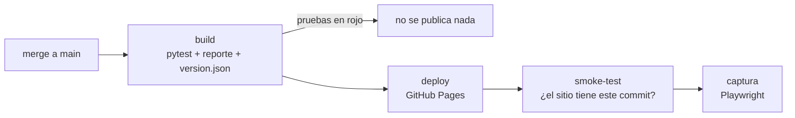
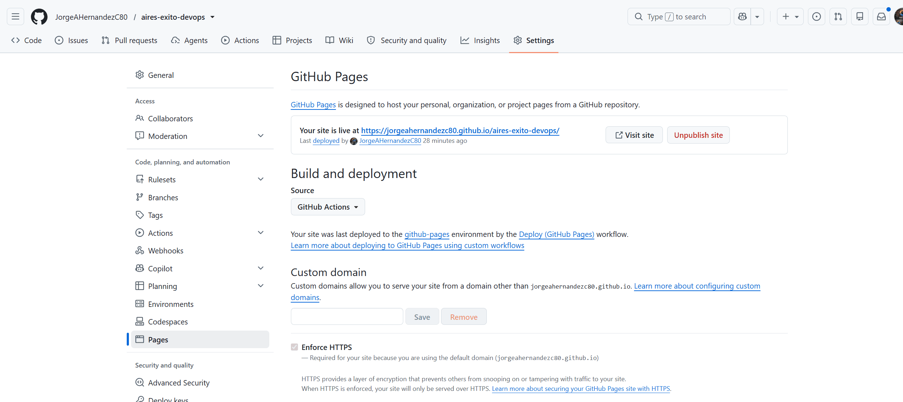
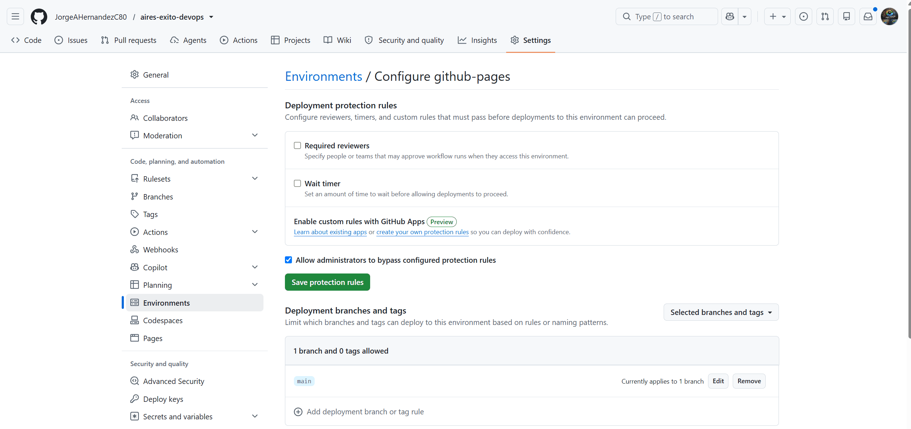
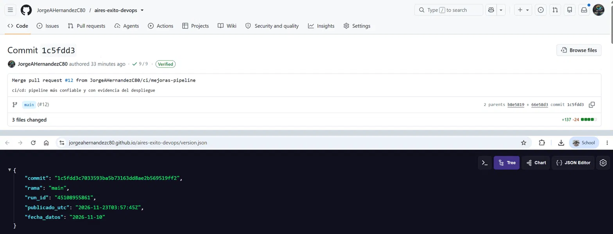
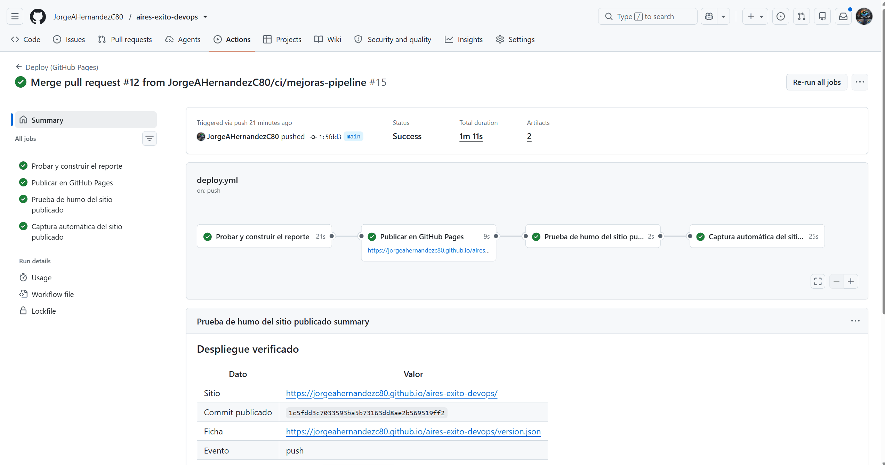
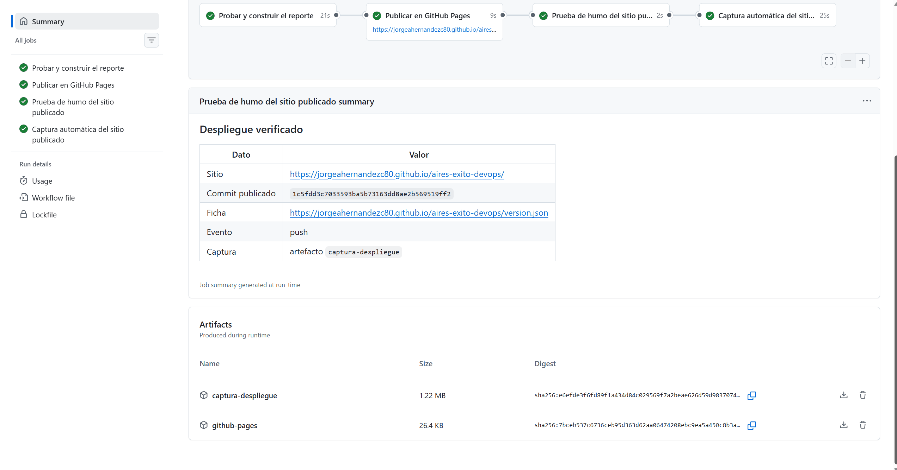
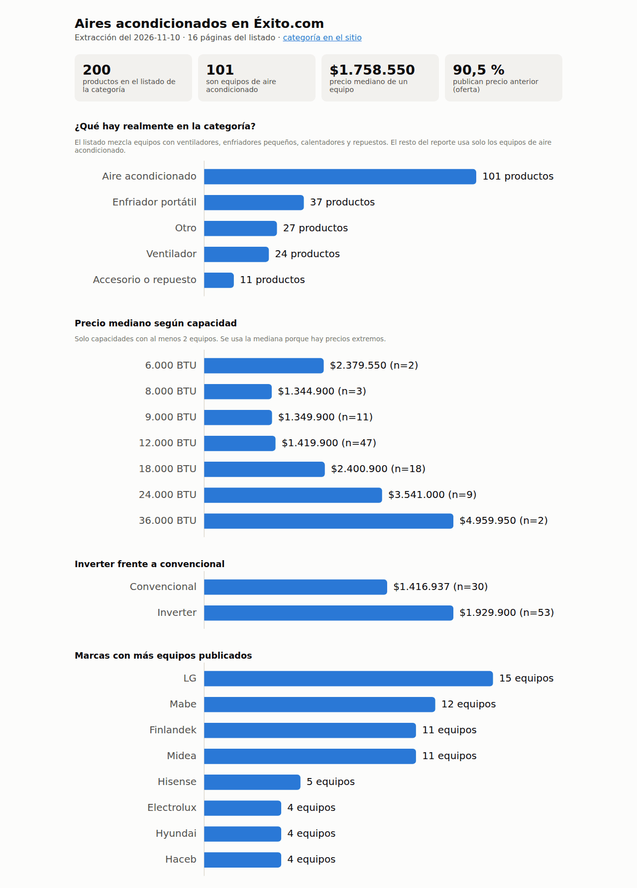

# Despliegue del reporte en GitHub Pages

Este documento explica cómo se publica el reporte de aires acondicionados, qué hay que
configurar en GitHub, qué variables y permisos usa el pipeline y cómo se comprueba que el
despliegue salió bien. Las capturas son del run
[45108955861](https://github.com/JorgeAHernandezC80/aires-exito-devops/actions/runs/45108955861),
el primero con la versión actual de `deploy.yml` (23 de noviembre de 2026, commit `1c5fdd3`).

**Sitio publicado:** https://jorgeahernandezc80.github.io/aires-exito-devops/
**Ficha del despliegue:** https://jorgeahernandezc80.github.io/aires-exito-devops/version.json

## Índice

1. [Qué se despliega y dónde](#1-qué-se-despliega-y-dónde)
2. [Configuración del servicio en GitHub](#2-configuración-del-servicio-en-github)
3. [El workflow paso a paso](#3-el-workflow-paso-a-paso)
4. [Variables de entorno y permisos](#4-variables-de-entorno-y-permisos)
5. [Cómo se comprueba el despliegue](#5-cómo-se-comprueba-el-despliegue)
6. [Cómo desplegar a mano](#6-cómo-desplegar-a-mano)
7. [Cómo deshacer un despliegue](#7-cómo-deshacer-un-despliegue)
8. [Decisiones de diseño y limitaciones](#8-decisiones-de-diseño-y-limitaciones)

## 1. Qué se despliega y dónde

Lo que se publica es un **sitio estático**: el comando `python -m aires_exito reporte` lee el CSV
limpio y genera la carpeta `_site/` con estos archivos:

| Archivo | Contenido |
|---|---|
| `index.html` | El reporte: cifras principales, gráficos en SVG y la tabla filtrable de equipos |
| `datos.csv` | Copia del CSV limpio, para descargar |
| `resumen.json` | Las cifras del reporte en formato JSON |
| `version.json` | La ficha del despliegue (la agrega el pipeline, ver la sección 5) |

El servicio de alojamiento es **GitHub Pages**. Se eligió porque el sitio no necesita servidor
(no hay base de datos ni API: todo se calcula en el build), Pages es gratuito para repositorios
públicos, sirve el sitio por HTTPS sin configurar certificados y se integra con GitHub Actions
sin guardar ninguna credencial.



## 2. Configuración del servicio en GitHub

Esto se configura una sola vez, desde *Settings* del repositorio.

### 2.1 GitHub Pages

*Settings → Pages → Build and deployment → Source:* **GitHub Actions**.

Con esta opción Pages no construye nada por su cuenta (no ejecuta Jekyll): publica exactamente el
artefacto que le entrega el workflow. La otra opción, *Deploy from a branch*, publicaría el
contenido de una rama, y el sitio dejaría de pasar por las pruebas.

*Enforce HTTPS* aparece marcado y deshabilitado porque es obligatorio con el dominio
`github.io`: el sitio solo se sirve cifrado.



> Si Pages no está activado, el paso `configure-pages` falla. Fue el primer error que tuvimos al
> publicar (ver [bitacora.md](bitacora.md), 9 de noviembre).

### 2.2 El entorno `github-pages`

GitHub crea este entorno automáticamente al activar Pages con GitHub Actions. Está en
*Settings → Environments → github-pages*, y el job `deploy` lo usa con `environment: github-pages`.

| Ajuste | Valor actual | Qué significa |
|---|---|---|
| Deployment branches and tags | Solo `main` | Ninguna otra rama ni etiqueta puede publicar, aunque alguien ejecute el workflow desde ella |
| Required reviewers | Desactivado | Nadie tiene que aprobar: cada merge a `main` se publica solo (despliegue continuo) |
| Wait timer | Desactivado | El despliegue empieza apenas termina el build |
| Allow administrators to bypass | Activado | El administrador del repo puede saltarse las reglas (ver la sección 8) |
| Environment secrets | Ninguno | El despliegue no necesita secretos (ver la sección 4) |



## 3. El workflow paso a paso

El archivo es [`.github/workflows/deploy.yml`](../.github/workflows/deploy.yml). Corre con cada
push a `main` (es decir, con cada merge de un PR) y también se puede lanzar a mano.

### Configuración general

| Clave | Valor | Para qué |
|---|---|---|
| `on.push.branches` | `[main]` | Solo se despliega lo que ya pasó por un PR y está en `main` |
| `on.workflow_dispatch` | — | Permite volver a desplegar desde *Actions → Run workflow* |
| `permissions` | `contents: read` | Permiso por defecto: solo leer. Cada job pide lo que necesita |
| `concurrency.group` | `pages` | Un solo despliegue a la vez |
| `concurrency.cancel-in-progress` | `false` | No se interrumpe un despliegue que ya está publicando. Si llegan varios merges seguidos, GitHub deja en espera solo el más reciente |

### Job `build` — probar y construir (timeout: 10 min)

| Paso | Comando o acción | Para qué |
|---|---|---|
| Descargar el código | `actions/checkout@v7` | Trae el commit que disparó el workflow |
| Instalar Python | `actions/setup-python@v7` con `3.12` y caché de pip | La caché evita descargar las dependencias en cada run |
| Instalar el paquete | `pip install -e ".[dev]"` | El paquete y las herramientas de prueba |
| Puerta de calidad | `pytest -q` | Si alguna prueba falla, el job se detiene y no se publica nada |
| Construir el sitio | `python -m aires_exito reporte --salida _site` | Genera `index.html`, `datos.csv` y `resumen.json` |
| Ficha de despliegue | escribe `_site/version.json` | Deja en el sitio el commit, la rama, el run y las fechas |
| Verificar el sitio | `test -s`, `grep -q "<svg"` y `jq -e` | Comprueba que los archivos existen, que hay gráficos y que la ficha tiene el commit de este run |
| Preparar Pages | `actions/configure-pages@v6` | Lee la configuración de Pages del repositorio |
| Empaquetar | `actions/upload-pages-artifact@v5` con `path: _site` | Crea el artefacto `github-pages`, el único formato que `deploy-pages` puede publicar |

### Job `deploy` — publicar (timeout: 10 min)

| Paso | Comando o acción | Para qué |
|---|---|---|
| Publicar | `actions/deploy-pages@v5` | Publica el artefacto en el entorno `github-pages` |
| Salida `page_url` | `outputs.page_url` | Pasa la URL del sitio a los jobs siguientes |

### Job `smoke-test` — comprobar el sitio publicado (timeout: 5 min)

| Paso | Qué hace | Para qué |
|---|---|---|
| Comprobar el commit | Descarga `version.json?v=<sha>` hasta 10 veces, cada 15 s, y compara `commit` con `GITHUB_SHA` | Asegura que el sitio publicado es **este** commit y no la versión anterior guardada en caché |
| Comprobar el contenido | `curl` de la página y `grep` del título | Asegura que la página carga y muestra el reporte |
| Resumen del run | escribe una tabla en `GITHUB_STEP_SUMMARY` | Deja la evidencia del despliegue en la página del run |

### Job `captura` — evidencia automática (timeout: 10 min)

| Paso | Qué hace | Para qué |
|---|---|---|
| Instalar Playwright | `pip install playwright` y `playwright install --with-deps chromium` | Un navegador sin interfaz dentro del runner |
| Tomar la captura | abre el sitio a 1280 × 900 y guarda la página completa | Prueba visual de lo que se publicó |
| Guardarla | `actions/upload-artifact@v7`, artefacto `captura-despliegue`, 30 días | Se puede descargar desde la página del run |

## 4. Variables de entorno y permisos

### 4.1 No hay secretos

Este proyecto **no guarda ningún secreto**: ni en *Settings → Secrets and variables*, ni en el
entorno `github-pages`, ni en el código. Es una decisión de diseño, no un olvido.

Para publicar, el job `deploy` pide un **token OIDC** (`permissions: id-token: write`). GitHub lo
emite solo para ese job, dura unos minutos y dice quién lo pide: este repositorio, este workflow,
la rama `main` y el entorno `github-pages`. `deploy-pages` se autentica con ese token. Así no hay
ninguna contraseña que se pueda filtrar, que haya que cambiar de vez en cuando o que alguien
pueda copiar del repositorio.

### 4.2 Variables que usa el pipeline

Casi todas las crea GitHub en cada run; la única que definimos es `URL`, a partir de una salida del job `deploy`.

| Variable | La crea | Dónde se usa | Para qué |
|---|---|---|---|
| `GITHUB_SHA` | GitHub | `build`, `smoke-test`, `captura` | El commit del run: va en `version.json` y la prueba de humo lo compara |
| `GITHUB_REF_NAME` | GitHub | `build` | La rama, que va en `version.json` |
| `GITHUB_RUN_ID` | GitHub | `build` | El número del run, que va en `version.json` |
| `GITHUB_STEP_SUMMARY` | GitHub | `smoke-test` | Archivo donde se escribe la tabla del resumen del run |
| `GITHUB_EVENT_NAME` | GitHub | `smoke-test` | El evento que disparó el run (`push` o `workflow_dispatch`) |
| `URL` | Nosotros, desde `needs.deploy.outputs.page_url` | `smoke-test`, `captura` | La dirección del sitio publicado |
| Token OIDC | GitHub, solo en `deploy` | `deploy-pages` | Autenticar la publicación sin secretos |

El workflow de datos (`actualizar-datos.yml`) usa además `GITHUB_TOKEN`, que se pasa como
`GH_TOKEN` para que GitHub CLI pueda subir la rama y abrir el PR, y `GITHUB_OUTPUT`, para avisar
al resto de los pasos que el sitio bloqueó el scraping.

### 4.3 Permisos por job

| Job | Permisos | Por qué |
|---|---|---|
| `build` | `contents: read` | Instala dependencias de terceros: no debe poder publicar ni pedir tokens |
| `deploy` | `pages: write`, `id-token: write` | Es el único job que publica |
| `smoke-test` | ninguno (`{}`) | Solo hace peticiones HTTP al sitio público |
| `captura` | ninguno (`{}`) | Solo abre el sitio público y sube un artefacto |

Es el principio de **mínimo privilegio** aplicado a cada job. Si una dependencia del paso
`pip install` estuviera comprometida, correría dentro de `build`, que no puede publicar nada.

## 5. Cómo se comprueba el despliegue

### 5.1 La ficha `version.json`

El job `build` escribe este archivo en el sitio:

```json
{
  "commit": "1c5fdd3c7033593ba5b73163dd8ae2b569519ff2",
  "rama": "main",
  "run_id": "45108955861",
  "publicado_utc": "2026-11-23T03:57:45Z",
  "fecha_datos": "2026-11-10"
}
```

Con ella se puede recorrer el camino completo: el **commit** lleva al código, el **run_id** lleva
a la ejecución del pipeline, y la ficha está en el **sitio publicado**. Las dos fechas son
distintas a propósito: `publicado_utc` es cuándo se desplegó y `fecha_datos` es cuándo se hizo la
extracción. Desde que Éxito.com bloquea a los runners de GitHub (ver
[bitacora.md](bitacora.md)), el sitio puede desplegarse hoy con datos de días anteriores, y la
ficha lo deja a la vista.

Arriba, el commit en GitHub; abajo, la ficha publicada. El SHA es el mismo:



### 5.2 El resumen del run

Los cuatro jobs terminaron en verde. El commit que disparó el run (arriba) es el mismo que aparece
como publicado en la tabla *Despliegue verificado*:



El run deja dos artefactos: `github-pages` (el sitio que se publicó) y `captura-despliegue`. El
*digest* `sha256` de cada uno es la huella de su contenido: si cambiara un solo byte, el número
sería otro.



### 5.3 La captura automática

Tomada por el job `captura` dentro del pipeline, sin intervención manual
([página completa](img/04-sitio-publicado.png)):



## 6. Cómo desplegar a mano

Normalmente no hace falta: cada merge a `main` despliega solo. Para volver a publicar sin cambiar
el código (por ejemplo, si Pages tuvo una falla):

1. *Actions* → **Deploy (GitHub Pages)** → **Run workflow**.
2. Elegir la rama `main` y confirmar.

Si se elige otra rama, el job `deploy` falla: el entorno `github-pages` solo acepta `main`
(sección 2.2).

## 7. Cómo deshacer un despliegue

Como solo `main` puede publicar, no se puede desplegar una etiqueta o un commit viejo. El
rollback se hace **hacia adelante**, con un commit que deshace el cambio:

```bash
git switch main
git pull
git revert --no-edit <sha-del-commit-con-el-problema>
git push
```

El revert pasa por el CI, el Deploy publica la versión anterior y `version.json` muestra el commit
del revert. Es más lento que un botón de "volver" (hay que esperar al CI y al Deploy, unos pocos
minutos), pero queda registrado en el historial y no se salta ninguna prueba.

## 8. Decisiones de diseño y limitaciones

- **Despliegue continuo, no entrega continua.** No hay aprobación manual: lo que llega a `main`
  se publica. Para pasar a entrega continua bastaría activar *Required reviewers* en el entorno
  `github-pages`; el job `deploy` quedaría esperando la aprobación de una persona. Para un reporte
  académico se prefirió la velocidad.
- **El administrador puede saltarse las reglas.** *Allow administrators to bypass* está activado.
  En un proyecto individual es práctico, pero en un equipo convendría desactivarlo: una regla que
  el administrador se puede saltar no protege contra los errores del administrador.
- **Las pruebas corren dos veces.** El CI ya probó el commit, y el `build` del Deploy vuelve a
  correr `pytest`. Se podría desplegar con `workflow_run` cuando termine el CI, pero así el Deploy
  dependería de otro archivo. Se prefirió que cada workflow se entienda solo.
- **Los artefactos se borran a los 30 días.** Por eso las capturas de este documento están
  guardadas en `docs/img/`.
- **Los datos pueden no ser de hoy.** El despliegue funciona siempre, pero la extracción desde
  GitHub Actions está bloqueada por Cloudflare. Los datos se actualizan en local con
  `scripts/actualizar_datos_local.ps1` (ver el README) y se publican al fusionar ese PR.