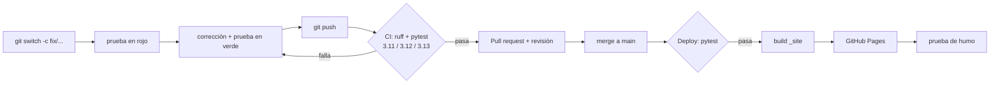

# Cómo funciona el flujo DevOps del proyecto

## 1. Ramas: GitHub Flow

La única rama que se queda para siempre es `main`, y la idea es que siempre esté lista para
publicarse. Todo lo demás lo hacemos en ramas cortas, y el prefijo dice para qué es cada una:

| Prefijo | Para qué la usamos | Ejemplos de este repo |
|---|---|---|
| `feature/` | algo nuevo | `feature/modularizar-scraper`, `feature/reporte-web` |
| `fix/` | arreglar un error | `fix/parser-nombre-vendedor`, `fix/normalizar-marcas-btu` |
| `test/` | pruebas | `test/pruebas-unitarias` |
| `ci/`, `cd/` | el pipeline | `ci/github-actions`, `cd/github-pages` |
| `docs/` | documentación | `docs/readme-flujo-devops` |

Para los mensajes de commit usamos la convención *Conventional Commits* (`feat:`, `fix:`, `test:`,
`ci:`, `data:`, `docs:`, `refactor:`). Así, mirando el historial, se entiende rápido qué tipo de
cambio fue cada uno.

## 2. Qué pasa con cada cambio

1. **Rama**: `git switch -c fix/<tema>` desde un `main` actualizado.
2. **Primero la prueba**: escribimos una prueba que muestre el error (en rojo) y después lo arreglamos
   hasta que pase.
3. **Push**: esto dispara `ci.yml`, que corre ruff y pytest en tres versiones de Python y pide
   mínimo 85 % de cobertura.
4. **Pull request**: tiene una plantilla en `.github/pull_request_template.md`. Solo lo fusionamos si
   el CI salió en verde.
5. **Merge a main**: esto dispara `deploy.yml`, que vuelve a correr las pruebas, arma el reporte,
   lo publica en GitHub Pages y revisa que la página sí responda.

## 3. Los pipelines

| Workflow | Cuándo corre | Qué hace |
|---|---|---|
| `ci.yml` | push a cualquier rama, PR a main | `ruff check`, `ruff format --check`, `pytest --cov` en 3.11–3.13 y guarda `coverage.xml` |
| `deploy.yml` | push a main, o a mano | pytest → `python -m aires_exito reporte` → Pages → prueba de humo |
| `actualizar-datos.yml` | lunes 06:17 (hora Colombia), o a mano | scraping con Selenium → `validar` → `limpiar` → PR automático con los datos |
| Dependabot | cada mes | abre PRs para actualizar las acciones y las dependencias |

Las pruebas no necesitan internet ni Chrome. El scraper recibe una función
`obtener_html(pagina)`: en producción usa Selenium y en las pruebas lee HTML guardado.

## 4. El conflicto de merge

`fix/normalizar-marcas-btu` y `feature/categoria-producto` salieron del mismo commit de `main`,
como pasa cuando dos integrantes del grupo trabajan al tiempo, y las dos tocaron `limpieza.py` y
`tests/test_limpieza_analisis.py`. Git pudo unir solo `limpieza.py` porque los cambios estaban en
partes distintas, pero en las pruebas sí hubo conflicto: las dos ramas cambiaron la misma línea
de `import` y agregaron pruebas al final del archivo. Lo resolvimos juntando los imports y dejando
las pruebas de las dos ramas. En el mensaje del commit de merge quedó explicado.

## 5. Lo que hay que configurar en GitHub

- *Settings → Pages → Build and deployment → Source*: **GitHub Actions**.
- *Settings → Actions → General → Workflow permissions*: marcar
  "Allow GitHub Actions to create and approve pull requests" (solo lo necesita
  `actualizar-datos.yml`).
- Si se quiere más control: *Settings → Branches* → una regla para `main` que pida que el check
  **CI** pase antes de poder fusionar.
